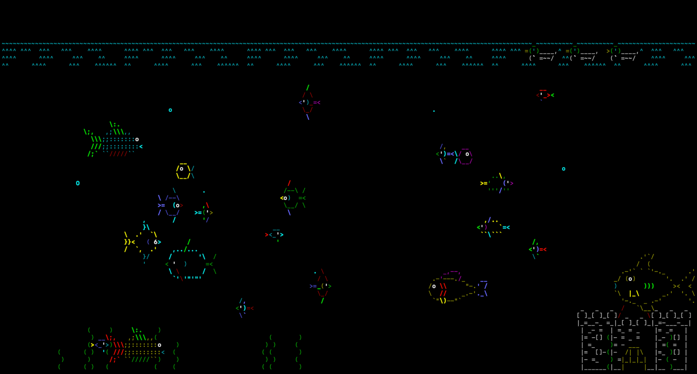

# Asciiquarium

An aquarium for your Mac's screen saver, drawn entirely in ASCII art. Fish, a castle, seaweed, bubbles and a
cast of passing visitors (a ship, a whale, a shark, a fishhook, ducks and more) swim across a tank that fills
each of your displays.

It is a native macOS port of [asciiquarium](https://github.com/nothub/asciiquarium), the terminal animation
by Kirk Baucom, rewritten in Swift with no third-party runtime code.



## Requirements

- macOS 15 or later
- Apple Silicon or Intel (the download is a universal binary)

## Install

1. Download `Asciiquarium-<version>.zip` from the
   [Releases page](https://github.com/MakeItAppenLabs/asciiquarium-saver/releases) and unzip it. You get
   `Asciiquarium.saver` and the `LICENSE` file.
2. Double-click `Asciiquarium.saver`. System Settings opens and asks whether to install it for your user
   only or for everyone on the Mac. Choose one and confirm.
3. In System Settings, open **Screen Saver** and choose **Asciiquarium** (it is listed under **Other**).
   Click **Options...** to change how it looks.

The saver is signed and notarized, so macOS opens it without a security warning.

**With Homebrew.** Instead of the steps above, run:

```sh
brew trust --cask makeitappenlabs/tap/asciiquarium-saver
brew install --cask makeitappenlabs/tap/asciiquarium-saver
```

Then choose Asciiquarium in System Settings as in step 3. The first line is needed once: Homebrew won't
load a cask from a third-party tap until you trust it, and without it `brew upgrade` can't update the
saver later. The cask is `asciiquarium-saver` because `brew install asciiquarium` is the original terminal
program. See [MakeItAppenLabs/homebrew-tap](https://github.com/MakeItAppenLabs/homebrew-tap).

**Upgrading.** After installing a new version over an old one, quit System Settings, then run
`killall legacyScreenSaver` in Terminal (or log out and back in). The system keeps the old version loaded until
then. If System Settings was open when you ran it, quit and reopen it: until you do, **Options...** won't open.

To remove it, delete `Asciiquarium.saver` from `~/Library/Screen Savers` (or `/Library/Screen Savers` if you
installed it for everyone).

## Settings

Choose **Options...** under the Asciiquarium thumbnail in System Settings, change what you like and click
**OK**. Cancel discards your edits.

| Option | Choices |
| --- | --- |
| **Fish amount** | A slider from Few to Many. The middle matches the density of the original terminal version. The number of fish also grows with the size of the screen. |
| **Creature set** | **Full** adds newer fish designs to the original eight. **Classic** draws only the eight original small fish and the original sea monster and big fish. |
| **Special creatures** | Twelve checkboxes: Ship, Whale, Sea monster, Big fish, Shark, Fishhook, Swan, Ducks, Dolphins, Submarine, Swordfish and Jellyfish. Only the ticked ones appear. All are on by default, in both creature sets. |
| **Background** | **Solid** (black unless you pick a color) or **Gradient** with a top and a bottom color. |
| **Text size** | **Small**, **Medium** or **Large**. Larger text means bigger creatures and fewer of them. |

Every display runs its own tank, so with several displays each shows different fish.

## Apple TV

There is also an Apple TV version, coming to the App Store. tvOS doesn't let apps add their own screen
savers, so it is an app you open: it fills the TV with the tank and keeps swimming until you leave.

| Remote | What it does |
| --- | --- |
| **Click** the touch surface | Drops the fishhook. Click again while it hangs in the water to reel it back up. |
| **Play/Pause** | Opens Options beside the tank, with the same settings as on the Mac. Changes show at once and are kept. |
| **Back** | Closes Options, or leaves the app. |

To protect OLED TVs from burn-in, after four hours without a button press the TV is allowed to dim or start
its own screen saver as usual. Any press starts the four hours again.

It needs tvOS 18 or later.

## Build from source

You need Xcode with the macOS 15 SDK (Swift 6) and [Homebrew](https://brew.sh).

```sh
brew install xcodegen
xcodegen generate
swift test
xcodebuild -project Asciiquarium.xcodeproj -scheme Asciiquarium -configuration Release -derivedDataPath build build
```

`xcodegen` creates `Asciiquarium.xcodeproj` from `project.yml` (the project file is not committed). `swift
test` runs the unit tests for `AquariumKit`, the pure-Swift package that holds the animation engine and the
creatures. The `xcodebuild` line produces `build/Build/Products/Release/Asciiquarium.saver`, signed to run
locally; double-click it to install it as above.

For quick iteration there is also a small windowed app that hosts the same view, without System Settings:

```sh
xcodebuild -project Asciiquarium.xcodeproj -scheme AsciiquariumPreview -configuration Release -derivedDataPath build build
```

It lands in `build/Build/Products/Release/AsciiquariumPreview.app`. It is a development tool and is never
part of a release.

The Apple TV app is the `AsciiquariumTV` scheme. To run it in the simulator (install the tvOS platform first
with `xcodebuild -downloadPlatform tvOS`):

```sh
xcodebuild -project Asciiquarium.xcodeproj -scheme AsciiquariumTV -destination 'platform=tvOS Simulator,name=Apple TV 4K (3rd generation)' -derivedDataPath build build
```

`xcodebuild ... test` with the same destination runs its UI tests, which press the remote and save screenshots
in the result bundle. To run it on your own Apple TV, pair it in Xcode (Window → Devices and Simulators) and
build with `-destination 'generic/platform=tvOS' DEVELOPMENT_TEAM=<your team ID> -allowProvisioningUpdates`.
The Debug build's `-exportArt <directory>` launch argument renders the app icon layers and Top Shelf images.

### Releasing (maintainers only)

`scripts/release.sh <version>` builds a universal Release, signs it with a "Developer ID Application"
certificate, submits it to Apple's notary service, staples the ticket and writes
`build/Asciiquarium-<version>.zip`, which holds `Asciiquarium.saver` and `LICENSE`. It needs that certificate in your keychain and a `notarytool` keychain
profile named `asciiquarium-notary` (`xcrun notarytool store-credentials asciiquarium-notary`). It stops at
the first error. `scripts/release.sh --dry-run <version>` prints the commands without running any of them.

## Reference sources

This port follows these pinned versions. Where the Perl program and the Python port differ, Perl wins.

- asciiquarium 1.6 (Perl): [`nothub/asciiquarium` at `3862efe`](https://github.com/nothub/asciiquarium/tree/3862efe961358d18649571e7dab4c18f7c2a74b0)
  (commit `3862efe961358d18649571e7dab4c18f7c2a74b0`)
- Term::Animation 2.6 (the Perl animation engine it runs on):
  [CPAN](https://metacpan.org/release/KBAUCOM/Term-Animation-2.6)
- asciiquarium-python (consulted as a cross-check only): [`MKAbuMattar/asciiquarium-python` tag `v2.4.2`](https://github.com/MKAbuMattar/asciiquarium-python/tree/v2.4.2)
  (commit `a83015df6c64cf3ef1ead493446d79eec33f0bf6`)

## License

This program is free software, released under the GNU General Public License version 3 or (at your option)
any later version (GPL-3.0-or-later). See [LICENSE](LICENSE).

It is a modified version of other people's work: a Swift port of asciiquarium 1.6 and of the Term::Animation
2.6 engine it runs on.

- The original asciiquarium is by Kirk Baucom and is released under GPL-2.0-or-later.
- Term::Animation is by Kirk Baucom and is released under the same terms as Perl itself.
- Most of the ASCII art (by Joan Stark and others) has no formal license. It is published here on the same
  terms as the upstream projects, with credit to each artist (see Credits below).

## Credits

This saver stands on a lot of other people's work.

- **Kirk Baucom**: wrote the original asciiquarium and the Term::Animation engine it runs on.
- **Joan Stark**: drew most of the ASCII art.
- **Claudio Matsuoka**: added the new species, backported from his Asciiquarium live wallpaper for Android.
- **driechers**: contributed the yellow submarine and restored elements that had been lost.
- **Carl Pilcher**: the ASCII art for the submarine.
- **robert1003**: implemented the swordfish.
- **ctr**: the ASCII art for the swordfish.
- **polettix**: assembled the contributions into one program.
- **Mohammad Abu Mattar**: wrote the Python port, used here as a cross-check.

The 1.6 source also credits UndeadLeech (background color and transparency), kronos-chenchang (the opening
castle door and a swordfish fix), Phani Rithvij (screensaver mode), Steven Ward (bug fixes and consistency
patches), Hugh Davenport (the new creature mode), Viggo Lekdorf (the transparency toggle), Marcin Kulik (a fix
for orphaned fishhook entities) and Jared Still (the jellyfish).
